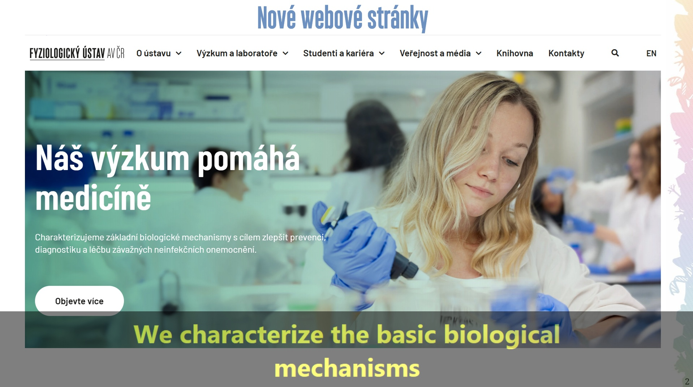
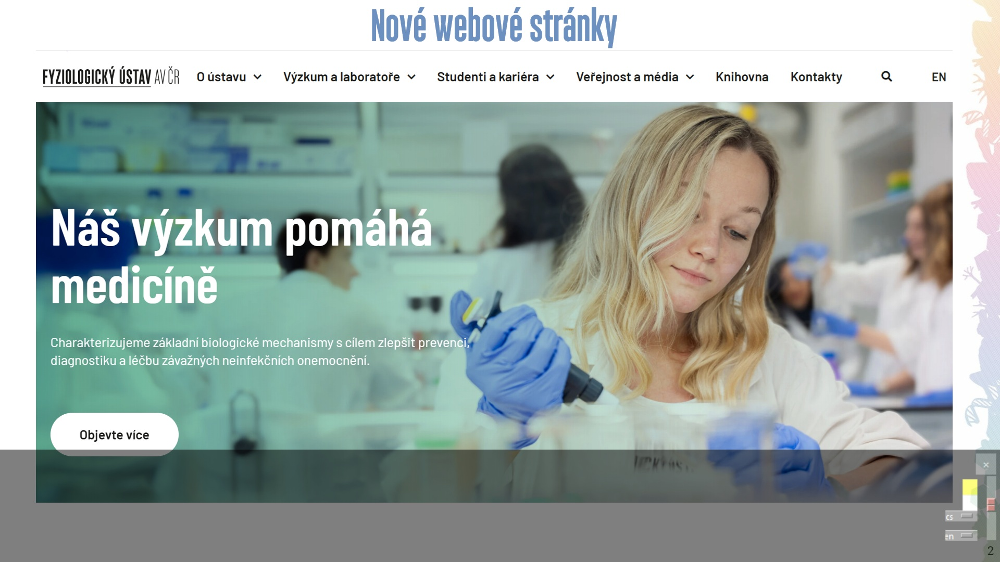

# Iris Assistant

## Iris for IPHYS Assistant

Iris for IPHYS Assistant is a modified version of the original [Iris
Assistant](https://github.com/mbursa/iris-assistant), adapted for a one-screen
setup. It is primarily designed for speech-to-subtitles use during a PowerPoint
presentation.

The application keeps the presentation in fullscreen mode and occupies the
bottom part of the screen with a transparent subtitle block. The subtitle window
is always displayed on top, so translated speech remains visible while the
presentation is running.



All settings can be configured in `config.toml`. Selected features can also be
changed interactively from the GUI menu:

- GUI menu is activated by mouse-over event and hides if not interacted with.
- The `X` button terminates the translation session and closes the subtitle window.
- The vertical scale bar changes the window transparency dynamically.
- The upper color picker changes the color of the newest translated sentence.
- The lower color picker changes the color of older translated sentences.
- The upper language selector chooses the input speech language.
- The lower language selector chooses the output subtitle language.
- Changing either language restarts the Soniox streaming session.



The compiled `Iris4IPHYS.exe` is available for download from the project
release/download location. To run the compiled version (Windows 11 Professional):

1. Download `Iris4IPHYS.exe` into a folder.
2. Place your `.env` file with your own Soniox API key in the same folder.
```
SONIOX_API_KEY=snx_....
IRIS_CONFIG_FILE=config.toml
```
3. Place the `config.toml` file with your specific configuration in the same folder.
```
...
[ui]
max_line_chars_approx = 42
window_resizable = true
window_background_color = "black"
window_text_color = "white"
window_font_family = "Segoe UI"
window_font_weight = "bold"
window_text_padding_x = 70
max_display_chars = 1200
...
```
4. Run the application.

The assistant is primarily intended for speech-to-subtitles use with PowerPoint
in fullscreen presentation mode. The subtitle window can be adapted for other
purposes by changing `config.toml`.

The application includes a custom Soniox context glossary for Czech-to-English
translation. It follows conventional translation terminology used by the Czech
Academy of Sciences and is stored in
[`soniox_context_cs_en.json`](soniox_context_cs_en.json).

## Below is the original description of the application for reference

Real-time speech-to-translation subtitle assistant powered by Soniox.

The app captures microphone audio, streams it to Soniox over WebSocket, and shows translated subtitles in a fullscreen-style desktop window.

## Features

- Real-time microphone capture (PCM 16-bit, mono)
- Soniox live one-way translation
- Large subtitle window for on-screen readability
- Typed, validated configuration with layered overrides

## Requirements

- Python 3.11+
- A valid Soniox API key
- Audio stack support for microphone input (PortAudio backend)

## Installation

1. Clone this repository.

### Ubuntu

Install the system audio, Tk, and Python build dependencies:

```bash
sudo apt-get update
sudo apt-get install -y \
  gcc \
  libsdl2-2.0-0 \
  libsdl2-dev \
  libportaudio2 \
  portaudio19-dev \
  python3-dev \
  python3-tk \
  python3-venv
```

`python3-tk` provides `tkinter` for Ubuntu's system Python. `tkinter` is an
optional Python standard-library component, not a package that `uv` installs
from PyPI. If you use a uv-managed Python and see
`ModuleNotFoundError: No module named 'tkinter'`, run the app with an installed
Python that includes Tk. For example, if `/usr/bin/python3` is Python 3.11 or
newer, use `uv run --python /usr/bin/python3 translator.py --source-lang cs`.

Choose one of the following Python environment setups.

### Option 1: uv

Install [`uv`](https://docs.astral.sh/uv/getting-started/installation/). The
dependencies are declared in both entry-point scripts and will be installed
automatically by `uv` when the application starts.

### Option 2: traditional venv

On Ubuntu, create and activate a virtual environment, then install the dependencies:

```bash
python -m venv .python
source .python/bin/activate
.python/bin/python -m pip install --upgrade pip
.python/bin/python -m pip install -r requirements.txt
```

### Windows

1. Install Python 3.11 or newer from [python.org](https://www.python.org/downloads/windows/).
   The standard Windows installer includes Tk support; if customizing the
   installation, include Tcl/Tk support so the `tkinter` module is available.
2. Install Git for Windows if you need it to clone the repository.
3. No separate SDL2 or PortAudio development packages are needed for the usual
   Windows installation; the Python packages provide the required runtime
   libraries.
4. Choose either `uv` or a virtual environment below. To check Tk support, run
   `py -3 -m tkinter`; a small demo window should open.

Install [`uv`](https://docs.astral.sh/uv/getting-started/installation/) for
Windows and use the `uv` commands in the Run section. For a virtual environment,
run these commands in PowerShell from the repository folder:

```powershell
py -3 -m venv .python
.\.python\Scripts\python.exe -m pip install --upgrade pip
.\.python\Scripts\python.exe -m pip install -r requirements.txt
```

## Configuration

Configuration is loaded in this order (later wins):

1. Built-in defaults
2. config.toml
3. .env
4. Process environment variables

When running the packaged EXE, `config.toml` and `.env` are read from the
process launch directory (the directory used to start the EXE), not from the
temporary application extraction directory. Supporting runtime files are kept
under `assets/`; the greeting audio and startup watermark are bundled inside
the EXE.

Quick setup:

1. Copy .env.example to .env
2. Set SONIOX_API_KEY in .env
3. Optional: copy config.toml.example to config.toml and tune values
4. Run the translator with its source language using either the `uv` or `venv` command below.

In Windows PowerShell, use `Copy-Item .env.example .env` to create the `.env` file.

Required:

- SONIOX_API_KEY: Soniox API key

Common environment overrides:

- IRIS_CONFIG_FILE
- IRIS_DISPLAY_ONLY_FINAL_TRANSLATIONS
- IRIS_WINDOW_FONT_SIZE

For a complete reference of configuration options, see `doc/configuration.md` file.

## Run

From the project root, run either executable entry point with `uv`. It reads
the dependencies declared in the script, creates or reuses its managed
environment, and starts the application:

```bash
./translator.py --source-lang cs
```

The scripts can also be launched explicitly with `uv run`:

```bash
uv run translator.py --source-lang en
```

If you chose the traditional `venv` setup, activate it first and run the
scripts with its Python interpreter:

```bash
source .python/bin/activate
python translator.py --source-lang cs
```

On Windows, run the `uv` commands above from PowerShell. If you chose `venv`,
use its interpreter directly:

```powershell
.\.python\Scripts\python.exe translator.py --source-lang cs
```

The translator reads the default source (`cs`) and target (`en`) languages from
`config.toml`. Optional command-line arguments can override them:

```bash
./translator.py --source-lang de --target-lang en
```

Language codes are case-insensitive, and `cz` is normalized to `cs`. The
subtitle window also provides compact source and target language menus; changing
either menu restarts only the Soniox session and keeps the microphone running.

Press Escape or the hover-only close button to close the subtitle window.

## Project Layout

- [translator.py](translator.py): translated-subtitle entry point
- [src/app.py](src/app.py): translator orchestration
- [src/config.py](src/config.py): typed non-language settings loader and validation
- [src/languages.py](src/languages.py): language-code normalization and translation defaults
- [src/soniox.py](src/soniox.py): shared Soniox streaming and translation-token handling
- [src/microphone.py](src/microphone.py): shared microphone capture
- [src/subtitles.py](src/subtitles.py): thread-safe translated-subtitle state
- [src/window.py](src/window.py): Tkinter subtitle window
- [assets/](assets/): bundled audio, watermark, screenshots, and favicon assets
- [soniox_context_cs_en.json](soniox_context_cs_en.json): custom Czech-to-English Soniox glossary
- [doc/configuration.md](doc/configuration.md): complete configuration reference

## License

This project is licensed under the MIT License. See [LICENSE](LICENSE).
